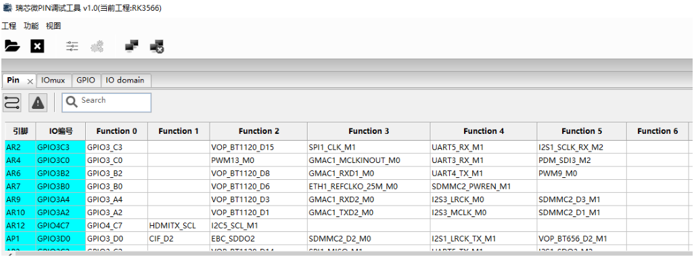
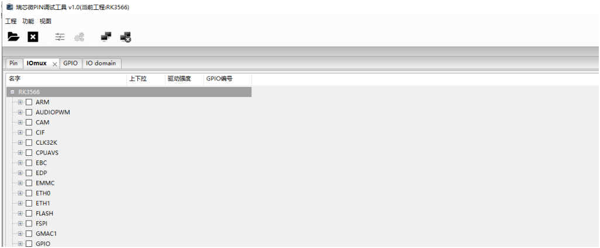
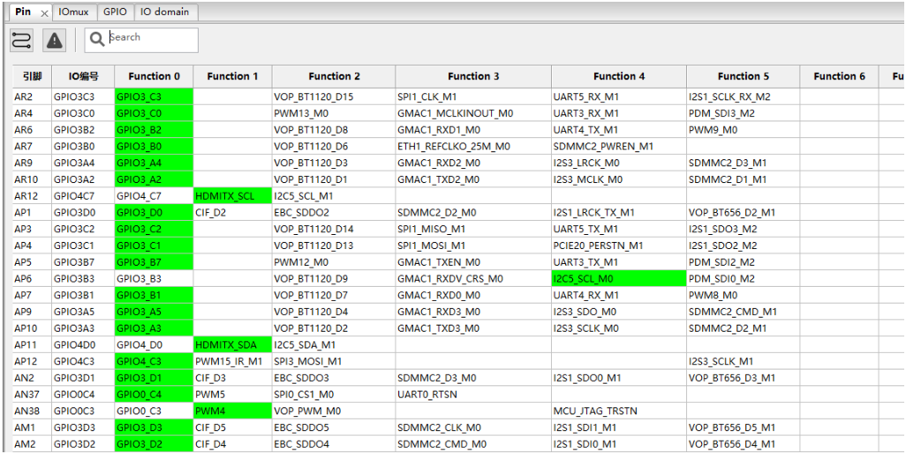
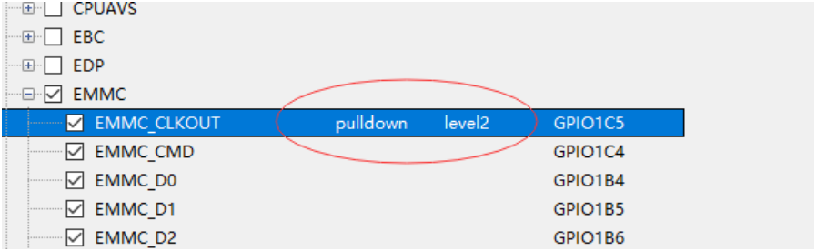
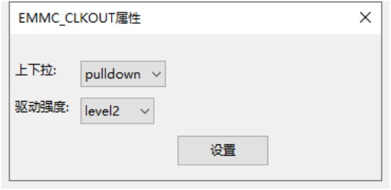
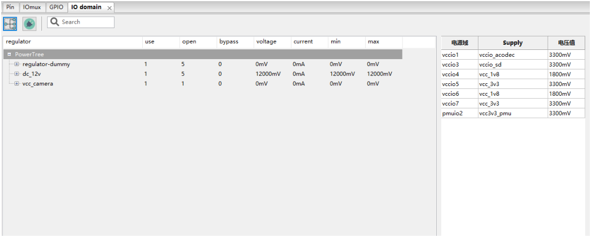

# PinDebug: IOMUX, GPIO und Spannungsdomänen auf Rockchip prüfen


## Vollständiger PinDebug-V1.1-Ablauf

Das Handbuch nennt RK3588, RK3566, RK3568, RV1126, RV1109, RV1106, RV1103 und RK3528. PinDebug liest IOMUX und konfiguriert Pin-Eigenschaften; Windows 1.18 und Linux 1.11 können andere Oberflächen haben. Es folgen die Quellabschnitte 1.1–1.11 mit chinesischen Originalabbildungen.

### 1.1 Projekt öffnen

Vor jedem Vorgang den SoC wählen. Die Pin-Seite zeigt Multiplexfunktionen nach Pin/GPIO: Function-Suche, Rechtsklick zum Ausgeben des Einstellbefehls, Doppelklick bei verbundenem Gerät zum direkten Anwenden. Pin- und IO-Nummern sind sortierbar. IOmux gruppiert die steuerbaren Signale nach Modul.


**Abbildung 1: Chip auswählen und Projekt öffnen**



**Abbildung 2: Pins und alternative Funktionen in der Pin-Ansicht**



**Abbildung 3: IOmux nach Funktionsmodulen anzeigen**

### 1.2 Gerät verbinden

Die Kommunikation erfolgt über ADB. Projekt öffnen, ADB am Gerät aktivieren, den Rechner verbinden und das Verbindungssymbol anklicken.


**Abbildung 4: Gerät verbinden**

### 1.3 IOMUX lesen

Alle IOMUX-Register lesen, um Pin und IOmux zu aktualisieren. Offline-Definitionen ersetzen keine tatsächlichen Gerätewerte.


**Abbildung 5: IOMUX vom Gerät lesen**


**Abbildung 6: Aktuelle Funktionen in der IOmux-Ansicht**



**Abbildung 7: Aktivierte Funktionen in der Pin-Ansicht hervorgehoben**

### 1.4 IOMUX ändern

Aktivieren eines Funktions-IO in IOmux wählt diese Funktion; Deaktivieren wählt GPIO. Bei Konflikten lässt sich die Änderung abbrechen oder bestätigen.


**Abbildung 8: Hinweis auf einen Funktionskonflikt**

### 1.5 Pull- und Treiberstärke

Einen aktivierten Funktions-IO markieren und per Rechtsklick Pull-Einstellung und Treiberstärke lesen oder ändern. Die Vorlage zeigt EMMC_CLKOUT; vor Änderungen die Nutzung durch den Speichercontroller prüfen.



**Abbildung 9: Pull-Widerstand und Treiberstärke von EMMC_CLKOUT anzeigen**



**Abbildung 10: Eigenschaften von EMMC_CLKOUT einstellen**

### 1.6 GPIO-Daten lesen und ändern

Das Beispiel verwendet GPIO1C3. Das GPIO-Häkchen zeigt den GPIO-Modus; Richtung stammt aus GPIO `ddr`, Ausgangspegel aus `dr`, IO-Spannung aus PMU `vsel`, Portpegel aus `ext_port`. `ddr` ist hier ein Richtungsregister, kein DDR-Speicher.


**Abbildung 11: GPIO-Zustand und Signalpegel**


**Abbildung 12: Eigenschaften von GPIO1C3 einstellen**

### 1.7 Regulator-Daten lesen

Das Werkzeug liest den regulator-summary-Knoten per `cat` und wertet alle Domains aus. Das Handbuch nennt keinen vollständigen Knotenpfad.


**Abbildung 13: Regulator-Informationen auslesen**



**Abbildung 14: Regulator- und Versorgungsdomäneninformationen**

### 1.8 Spannungsdomänen-Auswahl lesen

Das Spannungswahlregister wird als Domain-Liste dargestellt. Abschnitt 1.8 schreibt `vesl`, Abschnitt 1.6 `vsel`; diese Abweichung bleibt dokumentiert. Ein Auswahlwert ist keine gemessene Spannung.


**Abbildung 15: Spannungsdomänen-Auswahl auslesen**


**Abbildung 16: Vsel-Werte der Versorgungsdomänen**

### 1.9 IOmux prüfen

Ausgewählte IOs je Modul ausgeben, um bei mehreren Modi die tatsächlich aktive Gruppe zu bestimmen.


**Abbildung 17: IOmux-Konfiguration prüfen**


**Abbildung 18: Prüfergebnisse der IOmux-Modi nach Modul**

### 1.10 GPIO-Konfiguration exportieren

Nach dem Öffnen eines Projekts die GPIO-Konfiguration als Excel-Tabelle exportieren. Den SoC festhalten und statische Definitionen von gelesenen Gerätewerten unterscheiden.


**Abbildung 19: Exportierte GPIO-Konfigurationstabelle**

### 1.11 GPIO-Befehle offline nachschlagen

Bei geöffnetem Projekt lassen sich IOMUX-, Pull-, Treiberstärke- und Schmitt-Trigger-Befehle ohne Gerät nachschlagen. `help` zeigt die Syntax; die Vorlage demonstriert `gpio0a0`. Erzeugte Befehle bestätigen keine Eignung für die Trägerbeschaltung.


**Abbildung 20: GPIO-Befehlshilfe ohne Geräteverbindung**


**Abbildung 21: Registerbefehle für einen GPIO nachschlagen**

### Aus dem Screenshot übertragene Offline-Suchsyntax

Im Suchfeld des Werkzeugs eingeben, nicht in einer Shell. Reguläre Ausdrücke werden unterstützt. Export- und Suchbeispiele zeigen unterschiedliche Registeradressen; nicht zu einer Boardkonfiguration vermischen.

```text
gpio [mux|pull|ds|smt|ddr|dr]
gpio0a0
gpio0a0 mux
gpio0a0 pull
gpio0a0 ds
gpio0a0 smt
gpio0a0 ddr
gpio0a0 dr
gpio0a0 ddr|dr
```

## Geltungsbereich und Prüfung

Dieser Ablauf basiert auf der Dokumentation der Sammlung. Prüfen Sie Board, SoC, Trägerplatine, SDK/BSP und Host-Architektur. Flashen, Provisionieren, Registerschreiben und Hardwaretests wurden nicht ausgeführt. Ein verfügbares Paket belegt keine Unterstützung aller ArmSoM-Produkte.

## GitHub-Werkzeugverzeichnis, Versionen und SHA-256

Das passende GitHub-Verzeichnis öffnen, Host und Version wählen, Dateihash prüfen und vollständig entpacken. Die folgenden Links öffnen Repository-Verzeichnisse.

[Werkzeugverzeichnis auf GitHub öffnen](https://github.com/ArmSoM/rockchip-tools/tree/main/downloads/pin-debug)

| Plattform / Version | Datei | SHA-256 |
|---|---|---|
| Linux / 1.11 | `pin_debug_tool_v1.11_for_linux.tar.gz` | `16cb25b8fc2533e8f730a790c7486ab5042baa964b3bdb95a161ddce143c4a34` |
| Windows / 1.18 | `pin_debug_tool_v1.18_20250322_win.zip` | `88c550ee9a578eaa451a9b8a05b3d088247dc63dd9bd426b832191994dc6a7d5` |

[GitHub · catalog.json](https://github.com/ArmSoM/rockchip-tools/blob/main/catalog.json) · [SHA256SUMS](https://github.com/ArmSoM/rockchip-tools/blob/main/SHA256SUMS)

## Quellen und Originalabbildungen

- PinDebug_UserManual.pdf

## Verwandte Arbeitsabläufe

- [Rockchip Linux Pinctrl: vollständiger Leitfaden zu GPIO, IOMUX, Treiberstärke und DTS](https://blog.armsom.org/de/articles/116-rockchip-linux-pinctrl/)
- [USB SQ Tool 1.5: vom Augendiagramm zur USB-PHY-Konfiguration](https://blog.armsom.org/de/articles/rockchip-tool-usb-sq-tool/)
- [Rockchip-Werkzeug- und Downloadübersicht](https://blog.armsom.org/de/articles/rockchip-tools-download-guide/)

## Passende ArmSoM-Boarddokumentation

Board- und Trägeranforderungen zunächst im Produkthandbuch prüfen. Diese Links dienen als Plattformreferenzen und belegen keine Validierung des Archivwerkzeugs auf diesen Produkten.

[ArmSoM Docs](https://docs.armsom.org/) · [Sige7](https://www.armsom.org/sige7) / [Docs](https://docs.armsom.org/armsom-sige7) · [CM5](https://www.armsom.org/cm5) / [Docs](https://docs.armsom.org/armsom-cm5)

## Originalhandbuch auf GitHub lesen

- [PinDebug_UserManual.pdf](https://github.com/ArmSoM/rockchip-tools/blob/main/manuals/1cae2e2c0777.pdf)
