# RKDevTool: Download, Loader, Partitionen und update.img

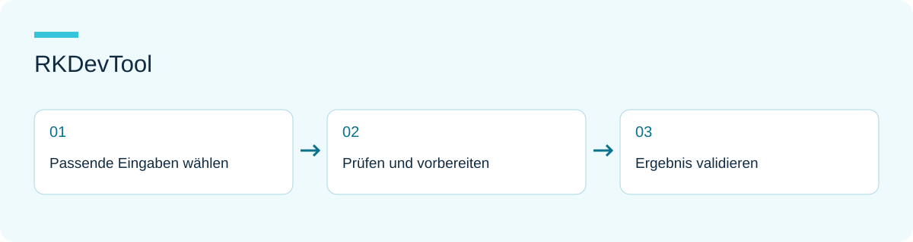

## RKDevTool-Handbuch: Partitionen, Firmware und erweiterte Vorgänge

Verbunden werden die chinesischen/englischen Handbücher V1.2 von 2018 und das chinesische V1.0 von 2021 für Werkzeug 2.88. Die Nummerierung ist nicht chronologisch: V1.2 ist nicht neuer. Das Paket selbst ist ein Stand mit Release Notes 3.37. Chinesische Abbildungen stammen aus der chinesischen, die übrigen aus der englischen Vorlage; nur 2021 ergänzte Ansichten behalten chinesische Beschriftungen. Alle technischen Funktionen beider Fassungen folgen.

### 1. Konfiguration anlegen, importieren und exportieren

#### 1.1 Konfiguration aus parameter anlegen

Zuerst prüfen, ob parameter zum aktuellen Projekt gehört. Im freien Bereich der Downloadkonfiguration rechtsklicken und den Konfigurationsimport wählen. Die folgende Ansicht zeigt das Menü in Werkzeug 2.88.

**Abbildung 1: Konfiguration über das Kontextmenü importieren**

Im Dateidialog `ParameterFile` und anschließend die parameter-Datei des Projekts wählen. Daraus erzeugt das Werkzeug die Partitionseinträge.

**Abbildung 2: ParameterFile als Dateityp für die Partitionskonfiguration wählen**

Nach dem Import unnötige Einträge löschen, den übrigen Abbilder zuweisen und den Zielspeicher wählen. Bei nur einem Speichertyp ist die Auswahl optional. Mitgelieferte Vorgaben passen nicht zwingend zum Projekt. Unten folgt der entsprechend beschriftete Import in V1.2 von 2018.

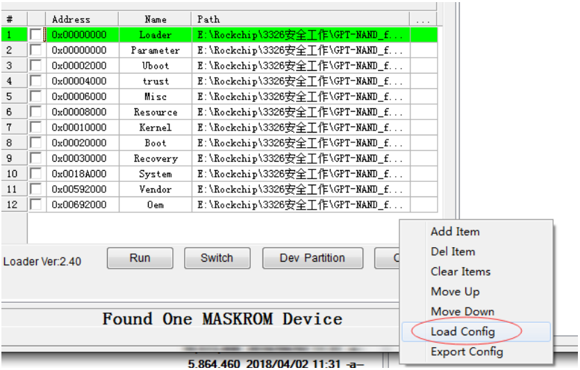

**Abbildung 3: Import der Partitionskonfiguration in V1.2**

#### 1.2 Konfiguration zur Wiederverwendung exportieren

Nach der Konfiguration im Downloadbereich rechtsklicken und als `ConfigFile` exportieren. Diese Datei beim nächsten Mal importieren. V1.2 beschreibt zusätzlich das Ersetzen von `config.cfg` im Werkzeugverzeichnis für das Laden beim Start.

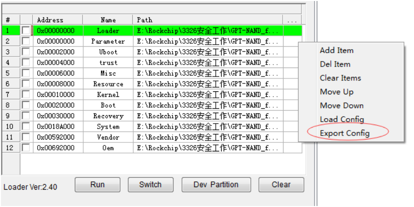

**Abbildung 4: Aktuelle Partitionskonfiguration exportieren**

#### 1.3 Startkonfiguration festlegen

Mit `DEFAULT_IMAGE_CONFIG` in `Config.ini` die beim Start zu ladende Datei festlegen. Nach dem Speichern das Werkzeug neu starten. Der abgebildete Pfad ist ein Quellbeispiel und muss zum eigenen Projekt passen.

**Abbildung 5: DEFAULT_IMAGE_CONFIG in Config.ini**

### 2. Boot laden oder Loader programmieren

#### 2.1 Boot nur in den Arbeitsspeicher laden

Der Boot-Download in Maskrom führt die DDR-Initialisierung des Loaders aus und lädt usbplug in DDR, ohne den Gerätespeicher zu beschreiben. Loader in der ersten Zeile doppelt anklicken, `LoaderToDDR` wählen, markieren und ausführen.

**Abbildung 6: LoaderToDDR lädt Update-Code in DDR, ohne den Speicher zu programmieren**

V1.2 von 2018 bietet auch den Weg über die erweiterten Funktionen: Boot-Datei wählen und Download anklicken. Auch dabei wird Boot in den Arbeitsspeicher geladen.

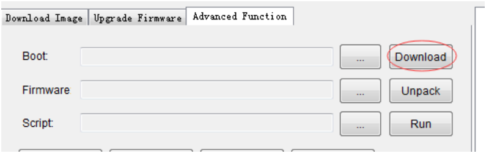

**Abbildung 7: Boot-Download über die erweiterten Funktionen in V1.2**

Auch die Downloadliste von V1.2 bietet `LoaderToDDR`. Beide Wege laden in den Arbeitsspeicher. Vor einem erneuten Versuch das Gerät neu starten und DDR-Lötstellen, SoC, passenden Loader sowie USB-Kommunikation prüfen.

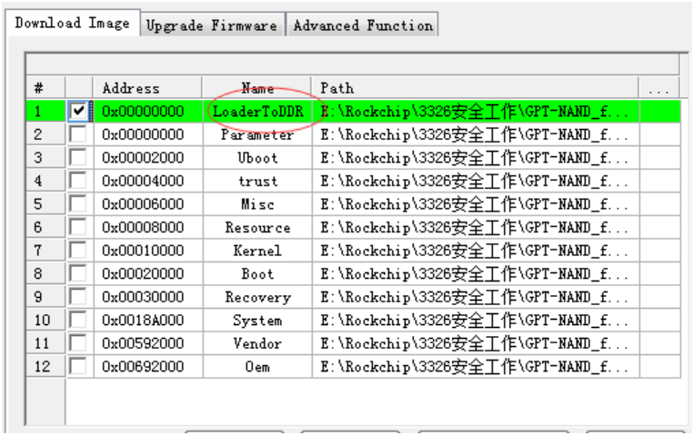

**Abbildung 8: LoaderToDDR in der Downloadliste von V1.2**

#### 2.2 Loader dauerhaft in den Speicher schreiben

Für dauerhaftes Schreiben in der ersten Zeile `Loader` wählen, markieren und ausführen. Maskrom und Loader werden unterstützt; dabei entsteht IDBlock und wird in den Speicher geschrieben. Zusätzlich zu DDR, SoC und USB Flash-Unterstützung, Lötstellen und Chip-Flag prüfen. Bei sporadischen Kommunikationsfehlern USB, bei reproduzierbaren die Geräteseite untersuchen.

**Abbildung 9: Loader erzeugt IDBlock und schreibt den Gerätespeicher**

### 3. Partitionsabbilder und Gerätetabelle

In Loader/Maskrom verbinden, bei Maskrom Loader markieren. Über parameter Adressen/Größen laden, Abbilder und Speicher zuweisen, Partitionen markieren und ausführen. Nulladressen nicht als korrekt voraussetzen. Device partition table in V1.2 liest und lädt die vorhandene Gerätetabelle. Fehlende/belegte Dateien, zu große Abbilder und USB-Fehler getrennt beheben.

**Abbildung 10: Markierte Einträge nach Prüfung von Partitionen, Abbildpfaden und Speicher ausführen**

Auch V1.2 verlangt die Prüfung jeder Partitionsadresse. Die Abbildung zeigt ein Maskrom-Gerät. Bei nicht korrekt geladenen Adressen zuerst die parameter-Datei des Projekts wählen, nicht einfach Nulladressen verwenden. Für die vorhandene Gerätetabelle liest, analysiert und lädt Device partition table die aktuelle Einteilung.

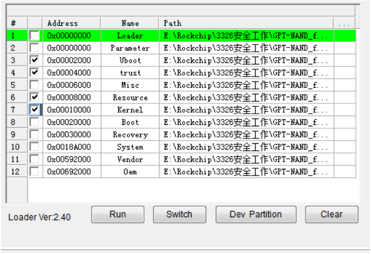

**Abbildung 11: Partitionsliste und Gerätestatus in V1.2**

### 4. Gerätemodi und Geräteauswahl

Wird das Gerät als ADB, MSC, MTP oder UVC erkannt, vor dem Flashen mit Switch in Rockusb Loader oder Maskrom wechseln. Die Abbildung zeigt ein ADB-Beispiel.

**Abbildung 12: ADB-Gerät mit Switch in den Rockusb-Modus versetzen**

Befindet sich das Gerät bereits in Loader, in den erweiterten Funktionen Enter Maskrom wählen. Anschließend den angezeigten Gerätestatus erneut prüfen.

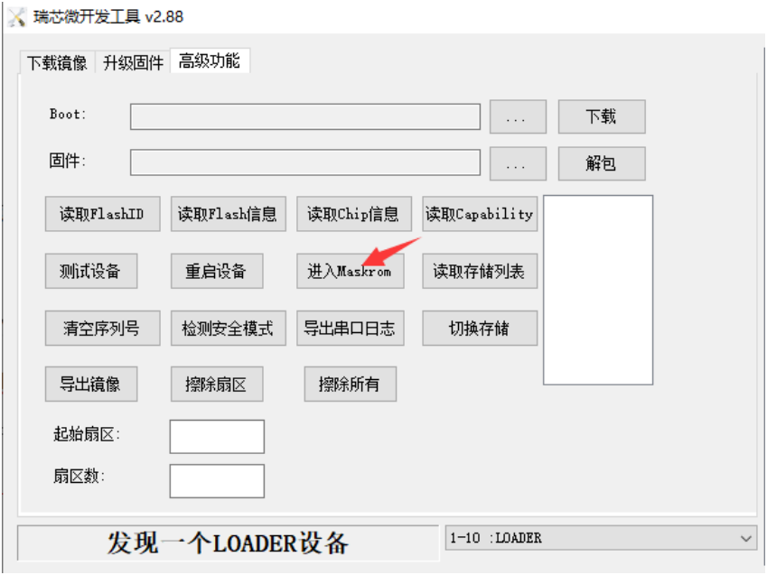

**Abbildung 13: Enter Maskrom in Werkzeug 2.88**

Unten ist der entsprechende Einstieg von V1.2 aus 2018 zu sehen; auch er setzt den Loader-Modus voraus.

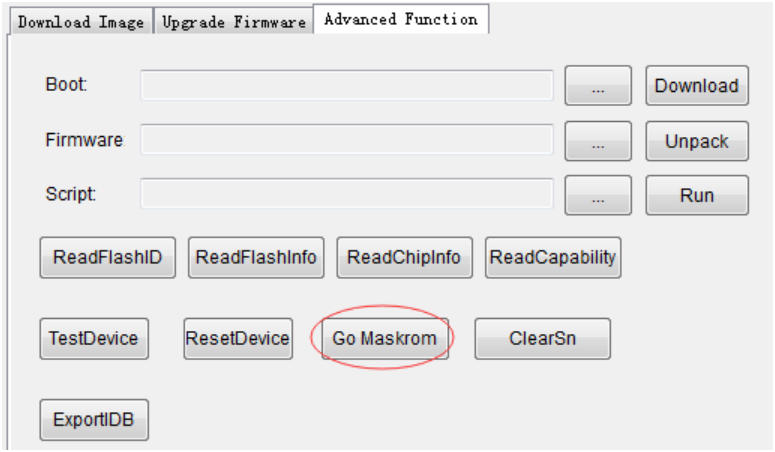

**Abbildung 14: Umschalten von Loader zu Maskrom in V1.2**

Bei mehreren angeschlossenen Geräten vor jedem weiteren Vorgang das Ziel im Auswahlfeld bestimmen. Die Meldung über ein erkanntes Gerät allein identifiziert noch nicht das gewünschte Schreibziel.

**Abbildung 15: Zielgerät bei mehreren verbundenen Geräten auswählen**

### 5. Vollständiges update.img-Update

update.img auswählen, in Maskrom/Loader verbinden und Upgrade anklicken. V1.2 akzeptiert hier auch Loader-Dateien. Dateizugriff, Format/Beschädigung, Hash, Packer-Version, Partitionsgröße, Chip-Flag und Kommunikation prüfen. Sporadische Fehler auf Kabel-, reproduzierbare auf Geräteseite untersuchen.

**Abbildung 16: update.img wählen, Gerätemodus prüfen und Update starten**

Unten folgt die Update-Oberfläche von V1.2 aus 2018. Firmware akzeptiert dort auch eine Loader-Datei. Vorher klären, ob ein vollständiges update.img oder nur Loader verarbeitet werden soll.

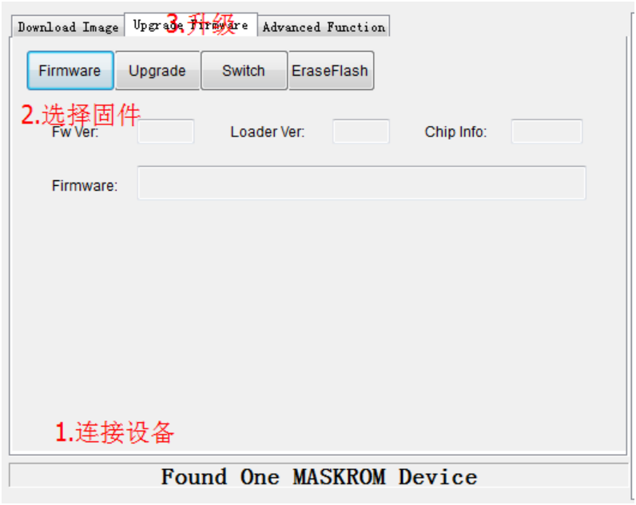

**Abbildung 17: Firmware-Auswahl und Upgrade-Bereich in V1.2**

### 6. Schreiben nach Adresse erzwingen

Force write by address aktivieren, Datei und Adresse festlegen, Eintrag markieren und ausführen. Das umgeht die normale Partitionsadressierung; tatsächliches Layout prüfen und keine falschen/zu großen Abbilder damit erzwingen.

**Abbildung 18: Bei erzwungenem Schreiben Datei, Adresse und Markierung prüfen**

### 7. Speicher löschen

Das Handbuch 2021 verlangt Maskrom und erfolgreichen Boot-Download vor dem Löschen. Sektorweises Löschen nennt nur eMMC, vollständiges `emmc|nor|nand`. Laut 2018 werden alle Blöcke einschließlich Systemblöcken vor der Firmware gelöscht. Das kann wiederholten Update-Fehlern vorausgehen, vernichtet aber Daten. Neuere SPI-Unterstützung der Kommandozeile nicht auf diese alte Oberfläche übertragen.

**Abbildung 19: Getrennte Bedienelemente für Sektor- und vollständiges Löschen**

### 8. Chip-Informationen lesen

Chip information lesen; `Image Chip Flag` muss dem beim Packen von Loader/Firmware verwendeten Flag entsprechen. Bei Abweichung die richtigen Chipdateien vorbereiten.

**Abbildung 20: Image Chip Flag in der Ausgabe von Read Chip prüfen**

Auch V1.2 zeigt das Chip-Flag im Ausgabebereich. Bei fehlgeschlagener Chipprüfung diesen Wert mit der Verpackungskonfiguration von Firmware oder Loader vergleichen.

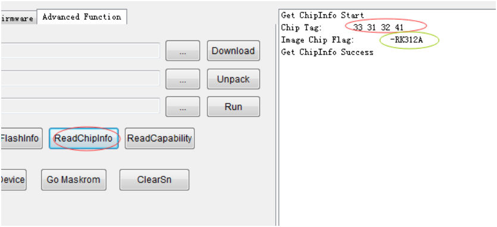

**Abbildung 21: Chip-Informationen und Image Chip Flag in V1.2**

Das folgende Verpackungsbeispiel markiert das Chip-Feld. Es zeigt die erforderliche Übereinstimmung mit dem ausgelesenen Flag; den Beispielwert nicht für ein anderes Board übernehmen.

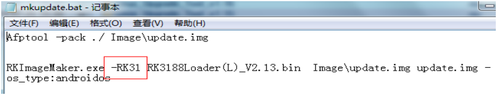

**Abbildung 22: Beispiel des Chip-Felds in der Verpackungskonfiguration**

### 9. Mehrere Speichertypen

In Maskrom Boot laden und Speicherliste lesen: Häkchen bedeutet aktuell, Kreuz nicht unterstützt, Kreis unterstützt. Einen Kreis-Eintrag wählen und Speicher umschalten.

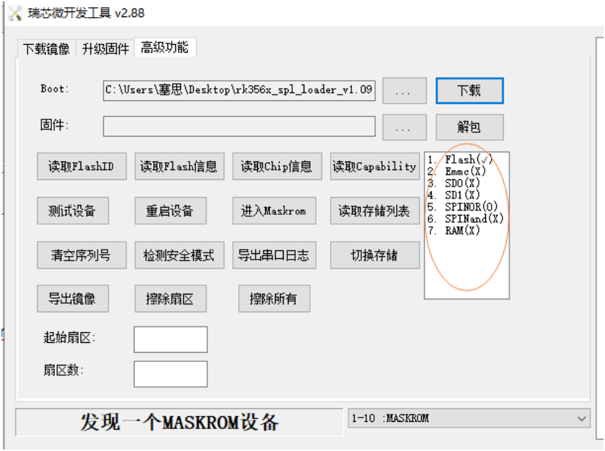

**Abbildung 23: Speicherliste lesen und zu einem unterstützten Ziel wechseln**

### 10. Firmware entpacken

Entpackt wird nach `output`: `boot.bin` ist der enthaltene Loader, `firmware.img` die interne afptool-Firmware und `Android` deren entpackter Inhalt. Quelldateinamen bleiben erhalten.

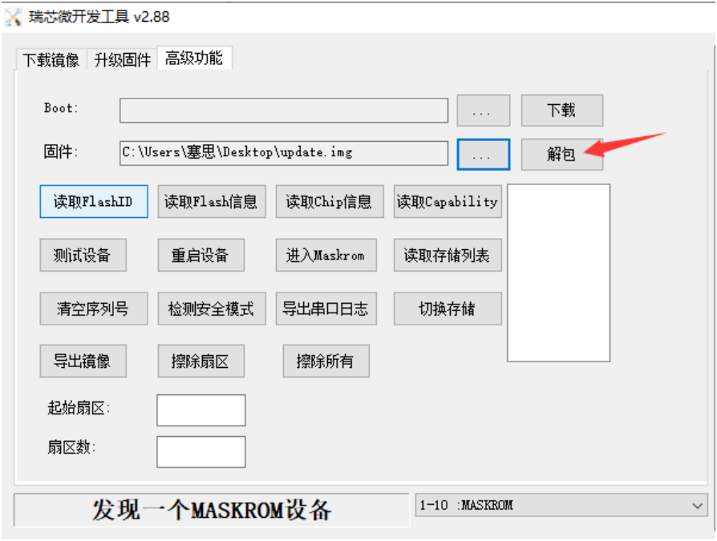

**Abbildung 24: Abbilder der ausgewählten Firmware mit Unpack entpacken**

In V1.2 liegt Unpack bei den erweiterten Funktionen. Das Ergebnis dient zur Prüfung des Firmware-Inhalts; Entpacken führt nicht automatisch einen Flash-Vorgang aus.

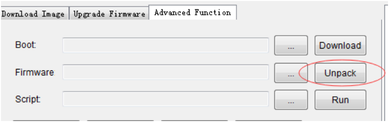

**Abbildung 25: Firmware entpacken über die erweiterten Funktionen von V1.2**

### 11. GPT und Fähigkeiten

V1.2 akzeptiert parameter oder `partition_table.img` für GPT. Bei parameter zuerst prüfen, ob `TYPE:GPT` enthalten ist.

**Abbildung 26: TYPE:GPT in parameter**

Die letzte Partition benötigt `grow`, um den verbleibenden Speicherplatz zu erhalten. Adressen und Namen des eigenen Projekts beibehalten, nicht das Beispiellayout kopieren.

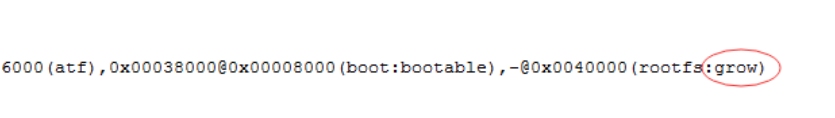

**Abbildung 27: grow-Eigenschaft der letzten Partition**

Nach Prüfung der Partitionsbeschreibung im Downloadbereich parameter oder das entsprechende GPT-Abbild wählen. Die Abbildung zeigt die Auswahl in V1.2.

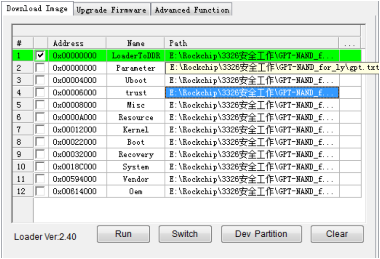

**Abbildung 28: GPT-Partitionsbeschreibung im Downloadbereich auswählen**

Vor dem Download `Read Capability` prüfen. `DirectLBA` muss aktiviert sein, andernfalls meldet das Werkzeug GPT als nicht unterstützt. Erzwungenes Schreiben nach Adresse hebt diese Voraussetzung nicht auf.

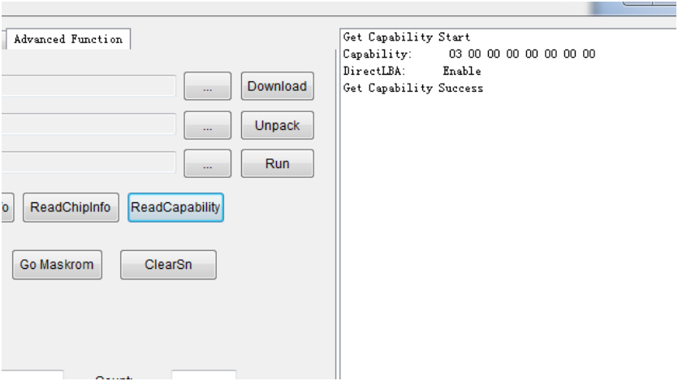

**Abbildung 29: DirectLBA in der Ausgabe von Read Capability**

### 12. Seriennummer löschen und Fehler prüfen

#### 12.1 Seriennummern löschen

Clear sn in V1.2 löscht Seriennummern, die mit dem Unified-Library-Werkzeug geschrieben wurden. Das englische Handbuch nennt zusätzlich SN/MAC in IDBlock sector3. Vorher festlegen, welche Geräteinformationen gelöscht werden sollen.

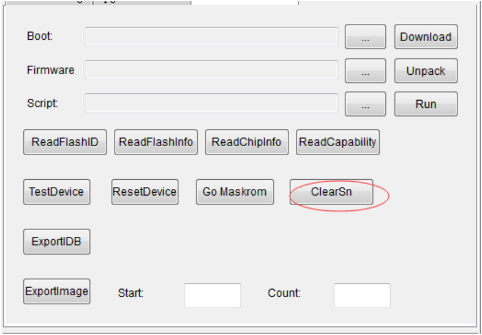

**Abbildung 30: Clear sn in V1.2**

#### 12.2 Download-Eintrag fehlt

Bei einem fehlenden Download-Eintrag den Abbildpfad der genannten Partition prüfen. Das chinesische Beispiel nennt kernel, das englische eine fehlende boot-Datei. Maßgeblich ist die konkrete Fehlermeldung.

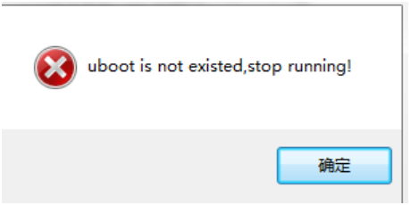

**Abbildung 31: Fehlender Download-Eintrag: die in der Meldung genannte Datei prüfen**

#### 12.3 Firmware lässt sich nicht laden

Prüfen, ob ein anderes Programm die Firmware-Datei belegt, das Format stimmt und die Datei unbeschädigt ist. Bei einer Chipprüfung mit Fehler zu Read Chip information zurückkehren und `Image Chip Flag` mit dem Flag in Loader/Firmware vergleichen.

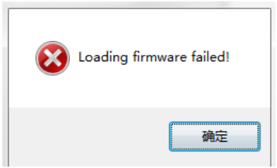

**Abbildung 32: Meldung beim fehlgeschlagenen Laden der Firmware**

#### 12.4 Fehler beim Download oder bei der Verifikation

- **Boot-Download fehlgeschlagen**: DDR-Lötstellen, SoC, passenden Loader und USB prüfen; vor Wiederholung neu starten.
- **Firmware-/Partitionsdownload fehlgeschlagen**: Chinesisch empfiehlt Updates für Rockusb und Werkzeug, Englisch nennt zusätzlich Werkzeug und Loader. Geschirmtes Kabel und hinteren PC-Port verwenden sowie Flash-Unterstützung, Lötstellen und Schäden prüfen.
- **Verifikation fehlgeschlagen**: prüfen, ob die parameter-Partitionen ihre Abbilder aufnehmen können; Flash-Mapping und DDR-Stabilität untersuchen. Die Quelle empfiehlt bei Bedarf Löschen vor erneutem Versuch; vorher den Datenverlust bewerten.

#### 12.5 Schreiben von GPT nicht unterstützt

Bei der folgenden Meldung über `Read Capability` prüfen, ob `DirectLBA` aktiviert ist, anschließend die GPT-Konfiguration des Projekts prüfen.

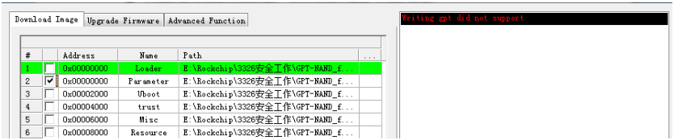

**Abbildung 33: Bei nicht unterstütztem GPT DirectLBA prüfen**

#### 12.6 Pfade, Berechtigungen und Konfigurationsänderungen

Auf nichtchinesischen Systemen einen englischen Werkzeugpfad verwenden. Englisch V1.2 verlangt ein Administratorkonto, Chinesisch nennt besonders Windows 7/Vista. Nach Änderungen an `Config.ini` das Werkzeug neu starten.

### Zusätzliche V1.2-Sprachunterschiede

Die englische Löschanleitung wählt zuerst update.img/loader.bin über Firmware, verbindet Maskrom/Loader und klickt EraseFlash; Chinesisch 2021 verlangt Maskrom und vorherigen Boot-Download. Nach konkreter Version vorgehen. Clear sn nennt englisch SN/MAC in IDBlock sector3, chinesisch die Seriennummer der Unified-Library-Anwendung. Englisch empfiehlt Werkzeug/Loader-Updates, chinesisch Rockusb/Werkzeug; beides prüfen. Englisch verlangt ein Administratorkonto allgemein, chinesisch nennt Win7/Vista ausdrücklich.

## Geltungsbereich und Prüfung

Dieser Ablauf basiert auf der Dokumentation der Sammlung. Prüfen Sie Board, SoC, Trägerplatine, SDK/BSP und Host-Architektur. Flashen, Provisionieren, Registerschreiben und Hardwaretests wurden nicht ausgeführt. Ein verfügbares Paket belegt keine Unterstützung aller ArmSoM-Produkte.

## GitHub-Werkzeugverzeichnis, Versionen und SHA-256

Das passende GitHub-Verzeichnis öffnen, Host und Version wählen, Dateihash prüfen und vollständig entpacken. Die folgenden Links öffnen Repository-Verzeichnisse.

[Werkzeugverzeichnis auf GitHub öffnen](https://github.com/ArmSoM/rockchip-tools/tree/main/downloads/rkdevtool)

| Plattform / Version | Datei | SHA-256 |
|---|---|---|
| Windows / 3.37 release notes | `RKDevTool-windows-directory-snapshot.zip` | `d453bd22c00141f12ef39469629d478aa61304763bdb2977288d6f019a74f20c` |

[GitHub · catalog.json](https://github.com/ArmSoM/rockchip-tools/blob/main/catalog.json) · [SHA256SUMS](https://github.com/ArmSoM/rockchip-tools/blob/main/SHA256SUMS)

## Quellen und Originalabbildungen

- RKDevTool_manual_v1.2_cn.pdf
- RKDevTool_manual_v1.2_en.pdf
- 开发工具使用说明_v1.0.pdf

## Verwandte Arbeitsabläufe

- [Rockchip-Speicherleitfaden: Flash, Startablauf, Partitionen, Programmierung und Vendor Storage](https://blog.armsom.org/de/articles/099-rockchip-storage-application/)
- [DriverAssitant 5.13: Rockusb- und ADB-Treiber unter Windows](https://blog.armsom.org/de/articles/rockchip-tool-driver-assistant/)
- [upgrade_tool: Rockchip-Firmware per Kommandozeile schreiben](https://blog.armsom.org/de/articles/rockchip-tool-upgrade-tool/)
- [Rockchip-Werkzeug- und Downloadübersicht](https://blog.armsom.org/de/articles/rockchip-tools-download-guide/)

## Passende ArmSoM-Boarddokumentation

Board- und Trägeranforderungen zunächst im Produkthandbuch prüfen. Diese Links dienen als Plattformreferenzen und belegen keine Validierung des Archivwerkzeugs auf diesen Produkten.

[ArmSoM Docs](https://docs.armsom.org/) · [Sige7](https://www.armsom.org/sige7) / [Docs](https://docs.armsom.org/armsom-sige7) · [CM5](https://www.armsom.org/cm5) / [Docs](https://docs.armsom.org/armsom-cm5)

## Originalhandbuch auf GitHub lesen

- [RKDevTool_manual_v1.2_cn.pdf](https://github.com/ArmSoM/rockchip-tools/blob/main/manuals/27081f89d32f.pdf)
- [RKDevTool_manual_v1.2_en.pdf](https://github.com/ArmSoM/rockchip-tools/blob/main/manuals/6a8a5813c129.pdf)
- [开发工具使用说明_v1.0.pdf](https://github.com/ArmSoM/rockchip-tools/blob/main/manuals/be6d064c5f70.pdf)
